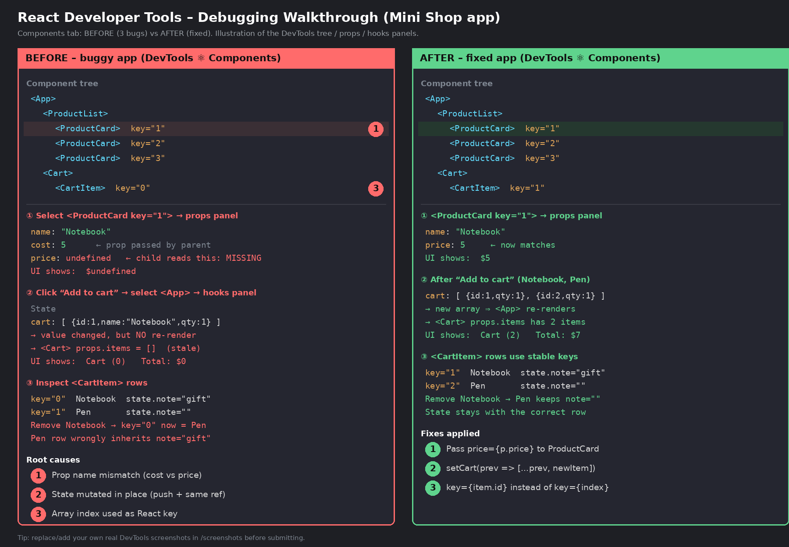

# Debugging a React App with React Developer Tools

**Checkpoint:** Debug a sample React application (state + props) using the React Developer Tools extension, document the process, and verify the fixes.



---

## 1. The sample app: "Mini Shop"

A small React (Vite) app with several components, props passing and state:

```
App                      <- owns `cart` state, addToCart / removeFromCart
├── ProductList          <- receives products + onAdd
│   └── ProductCard x3   <- receives name, price, onAdd
└── Cart                 <- receives items, onRemove; computes total
    └── CartItem xN      <- has its own local `note` state
```

Folders:
- `src/buggy/` – version that contains 3 deliberate bugs
- `src/fixed/` – corrected version
- `src/main.jsx` – change the import (`./buggy/App` or `./fixed/App`) to switch versions

## 2. Setup

```bash
npm install
npm run dev          # open the printed localhost URL
```

Install **React Developer Tools** (Chrome / Edge / Firefox extension, or standalone `npx react-devtools`).
Open the browser DevTools (F12) and go to the **⚛ Components** tab.

## 3. Debugging process

### Bug 1: Missing prop (`$undefined` price)
- **Symptom:** Every product card shows `$undefined`.
- **Inspect:** In **Components**, expand `App > ProductList` and select a `ProductCard`. The **props** panel shows `name`, `cost`, `onAdd`, but the component reads `price`, which is not there.
- **Cause:** `ProductList` passes `cost={p.price}` while `ProductCard` destructures `price`.
- **Fix:** Pass the correct prop name: `price={p.price}`.

### Bug 2: State changes but the UI does not update
- **Symptom:** Clicking "Add to cart" does nothing visible; the cart stays at `Cart (0)`.
- **Inspect:** Select `<App>` and watch **hooks → State**. Clicking the button changes the logged value, but `<Cart>`'s `items` prop stays `[]` and the component does not re-render (use the ⚙ setting "Highlight updates when components render" to confirm nothing flashes).
- **Cause:** `cart.push(...)` mutates the existing array and `setCart(cart)` passes the *same reference*, so React sees no change.
- **Fix:** Create a new array with a functional update:
  ```js
  setCart((prev) => [...prev, { ...product, qty: 1 }]);
  ```
  (The fixed version also increases `qty` if the item is already in the cart.)

### Bug 3: Input text "jumps" to the wrong row after removing an item
- **Symptom:** Type a note into the first cart row, remove that row, and the note appears on the next item.
- **Inspect:** Select the `CartItem` rows. The tree shows `key="0"`, `key="1"` (array indexes). After removal the remaining row becomes `key="0"` and reuses the old component's local `note` state.
- **Cause:** `key={index}` ties component identity to position, not to the item.
- **Fix:** Use a stable unique key: `key={item.id}`.

## 4. Summary of fixes

| # | Issue | Where | Fix |
|---|-------|-------|-----|
| 1 | Prop name mismatch (`cost` vs `price`) | `ProductList.jsx` | `price={p.price}` |
| 2 | State mutated in place | `App.jsx` | `setCart(prev => [...prev, item])` |
| 3 | Array index as key | `Cart.jsx` | `key={item.id}` |

## 5. Verification

With `src/main.jsx` importing `./fixed/App`:
1. Product cards show `$5`, `$2`, `$30`.
2. Clicking "Add to cart" updates the cart count and total immediately (Notebook + Pen = `$7`).
3. Adding the same product twice increases its quantity.
4. Typing a note in one row and removing a different row keeps the note on the correct item.
5. In DevTools the `ProductCard` props now show `price`, and `CartItem` keys are item ids.

Both versions compile with `npm run build`.

## 6. Key takeaways
- The **props panel** quickly exposes missing or misnamed props.
- The **hooks/state panel** shows what state actually holds versus what the UI shows.
- Never mutate state; always create new arrays/objects.
- Use stable, unique `key`s for list items.

> **Submission note:** `screenshots/devtools-before-after.png` is an annotated summary. Add your own real DevTools screenshots of the buggy and fixed app to `screenshots/` as well.
